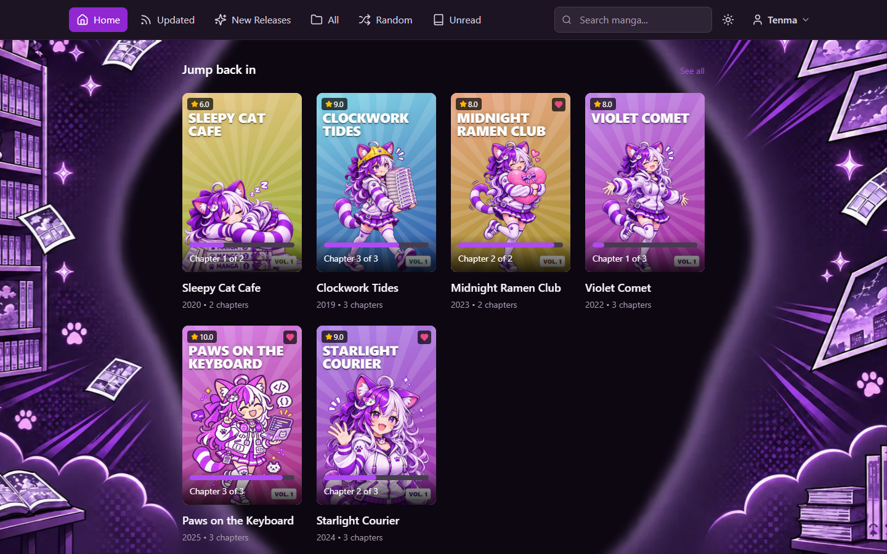
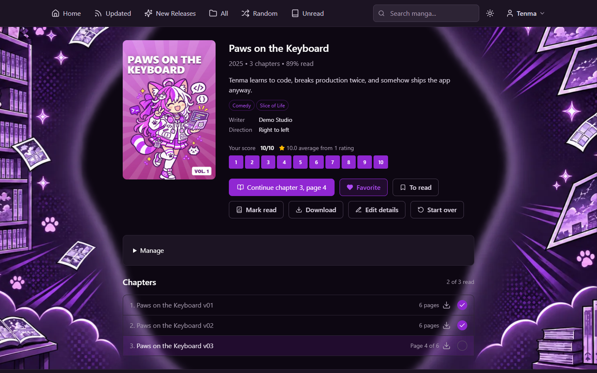
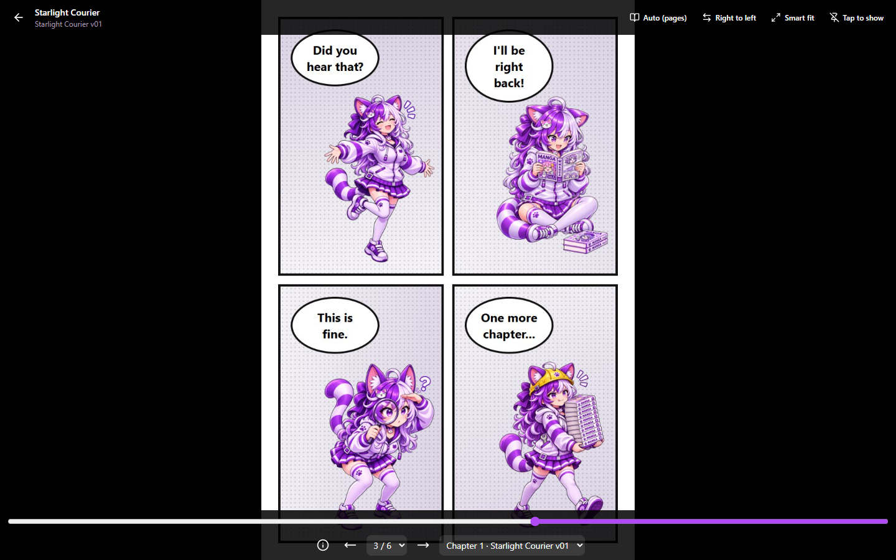
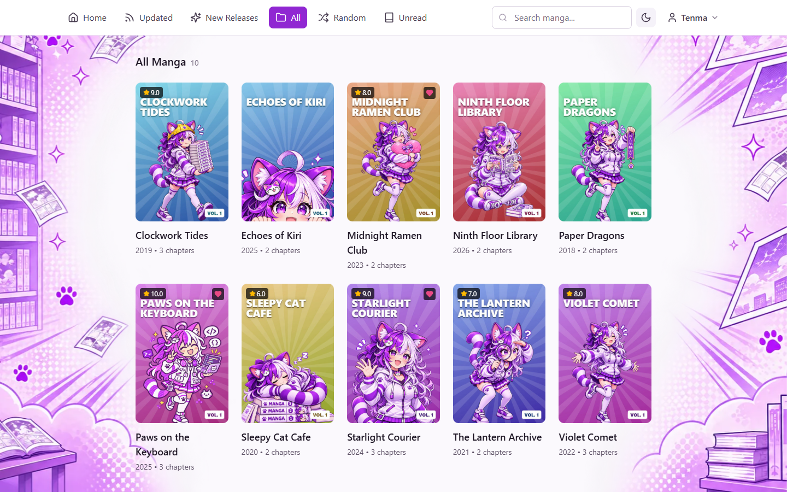
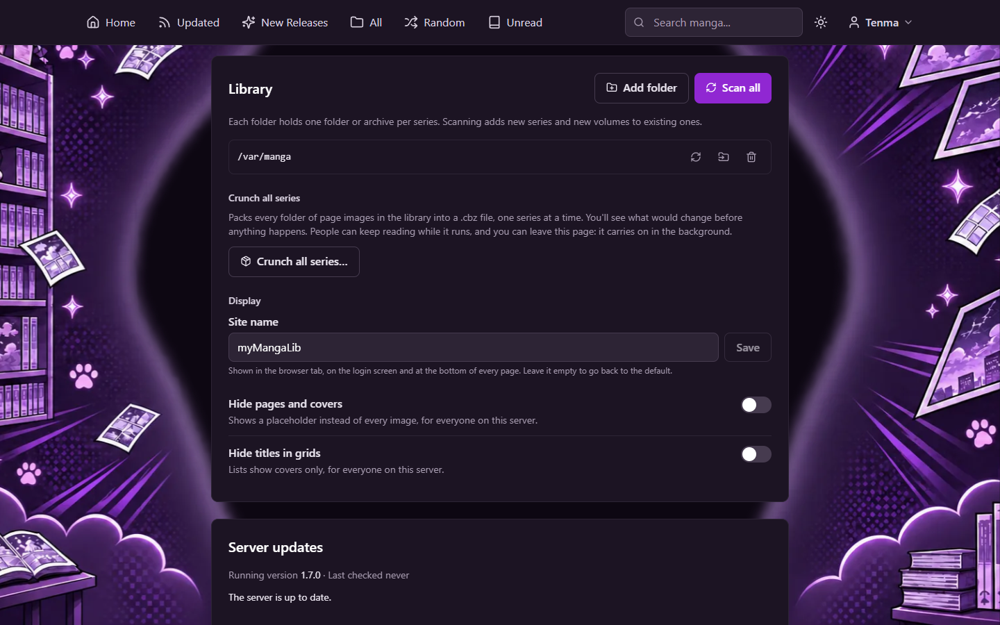
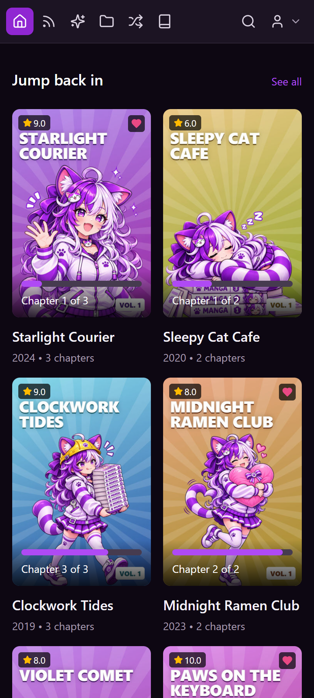
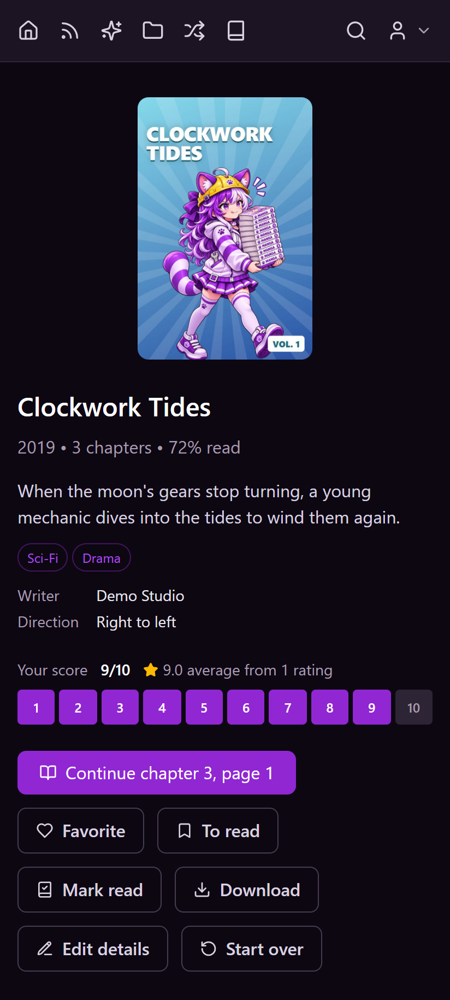
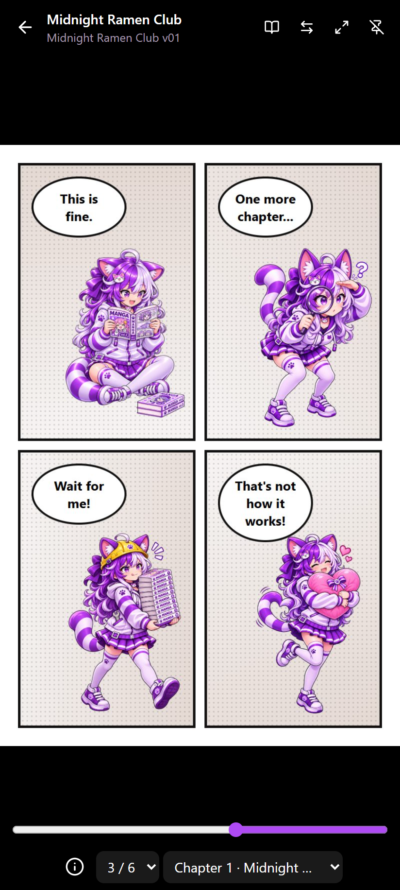
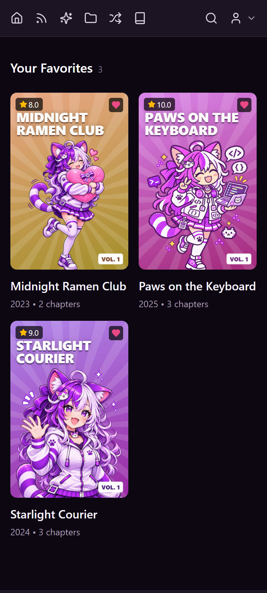

<p align="center">
  
</p>

<h1 align="center">myMangaLib</h1>

<p align="center">
  <b>Your manga, on your server, on any screen.</b><br>
  A self-hosted manga library with a web app, an installable browser app and an Android app.
</p>

<p align="center">
  <a href="#getting-started">Getting started</a> ·
  <a href="#key-features">Features</a> ·
  <a href="#screenshots">Screenshots</a> ·
  <a href="#things-to-keep-in-mind">Keep in mind</a> ·
  <a href="#developing">Developing</a> ·
  <a href="#license">License</a>
</p>



## About

myMangaLib turns a folder of manga on your own computer into a reading site that feels like the big manga websites, without handing your collection or your reading history to anyone else. Point it at your files, open it in a browser or on your phone, and pick up where you left off. Share it with family and friends with their own accounts, or keep it to yourself.

It's light enough for a Raspberry Pi: it has been run with over 1,000 titles and 76,000 pages on a Pi 5 that was also running other services.

## Key features

**Reading**
- A reader built for phones and desktops: tap zones, swipes, arrow keys and WASD.
- Right-to-left or left-to-right, page-by-page or a vertical webtoon scroll, and several ways to fit the page to the screen.
- Your place is saved as you read, on every device.

**Your library**
- Reads `.cbz`/`.zip` archives, PDFs and folders of images (`.jpg`, `.png`, `.webp`, `.gif`, `.jfif`).
- Series details (summary, year, writer, artist, genres, reading direction) from `ComicInfo.xml`, editable in the app.
- Search, tags and ready-made lists: Recently Updated, New Releases, Top Rated, Unread, Random, plus your Favorites, To Read queue, History and Bookmarks.
- Ratings out of 10 and read marks for every chapter.

**On the go**
- An Android app that connects to your server, remembers several servers and can be locked with your face, fingerprint or screen lock.
- Downloads for offline reading, in the Android app and in the browser (the site installs as an app).
- The Android app and the server both update themselves from GitHub Releases, after you say yes.

**Sharing and managing**
- Multiple accounts with owner, admin, moderator and reader roles. New sign-ups can wait for approval.
- Readers can suggest corrections to series details; admins approve them, and the changes are written back into the files.
- Owner tools in Settings: scan for new manga, move a library or a single series to another folder, pack loose images into `.cbz` files ("crunch") and back, rename the site, and install server updates with automatic rollback.
- Light and dark themes, accent colors and illustrated backgrounds.

**Hosting**
- One Docker command to run it. Works behind nginx, Caddy, Traefik and friends, at its own address or a sub-path, and alongside proxy logins like Authelia, Authentik or Cloudflare Access.
- The original "classic" interface is still there at `/classic/`.

## Screenshots

<table>
  <tr>
    <td width="50%"></td>
    <td width="50%"></td>
  </tr>
  <tr>
    <td></td>
    <td></td>
  </tr>
</table>

<table>
  <tr>
    <td></td>
    <td></td>
    <td></td>
    <td></td>
  </tr>
</table>

<sub>The manga in these screenshots are made up for the demo, starring Tenma.</sub>

## Getting started

### 1. Start the server

You need [Docker](https://docs.docker.com/get-docker/) (Docker Desktop on Windows and macOS). Change `/path/to/manga` to the folder that holds your manga:

```sh
docker run -d --name mangalib --restart unless-stopped -p 5000:5000 \
  -v mangalib-data:/data \
  -v /path/to/manga:/var/manga:ro \
  ghcr.io/xzcutable/mangalib --site-name "My Library"
```

**Or with Docker Compose:** put your manga in a `manga` folder next to [compose.yml](compose.yml) (or change `./manga` in it), then run `docker compose up -d`.

No Docker? See [Installing without Docker](docs/manual-install.md).

### 2. Create the owner account

Open http://localhost:5000. The first account you create is the **owner**, who can change every setting. Your manga is already there: the mounted folder is added and scanned on first start.

### 3. Organize your manga

One folder (or one archive) per series, with each volume or chapter as a `.cbz`, a `.pdf` or a folder of images:

```
manga/
├── Starlight Courier/
│   ├── Starlight Courier v01.cbz
│   └── Starlight Courier v02.cbz
└── Paper Dragons/
    ├── Chapter 1/   (001.jpg, 002.jpg, ...)
    └── Chapter 2/
```

Added more later? Copy it in, then **Settings → Library → Scan all**. More in [Your library](docs/library.md).

### 4. Read on your phone

- **Android:** install the app from [GitHub Releases](https://github.com/XZcutable/MangaLib/releases) and enter your server's address, for example `192.168.1.20:5000`.
- **Any phone or tablet:** open `http://<your computer's IP>:5000` in the browser. It can be installed to the home screen like an app.

### 5. Stay up to date

The server checks for new versions every few hours and downloads them in the background. Nothing changes until the owner clicks **Settings → Server updates → Apply and restart**. If the new version fails to start, it goes back to the old one. You can also `docker pull ghcr.io/xzcutable/mangalib` and recreate the container.

**Running a version from before the new interface?** Follow [UPGRADING.md](UPGRADING.md) first: the original Docker setup kept its database inside the container, so it has to be copied out before upgrading.

### Common options

Anything after the image name is a flag. The ones you're most likely to want:

| Flag | What it does |
|---|---|
| `--site-name NAME` | Name in the browser tab and the app |
| `--allow-new-users` / `--no-allow-new-users` | Let people create their own accounts |
| `--auto-approve-users` | New accounts can read without waiting for approval |
| `--no-auto-update` | Don't check for updates on its own |
| `--url-prefix /manga` | Served at a sub-path by a reverse proxy |

All flags, `config.toml` and environment variables: [Configuration](docs/configuration.md).

## Things to keep in mind

- **Back up `/data`.** It holds the database (accounts, progress, ratings), the config and the server's own database backups. Compose keeps it in `./data`. Replacing the container doesn't touch it.
- **Create the owner account right away,** before the server is reachable by anyone else. Whoever signs up first becomes the owner.
- **Use HTTPS for anything reachable from the internet.** Put the server behind a reverse proxy ([guide](docs/reverse-proxy.md)). Plain HTTP is fine on a home network.
- **A proxy login page blocks the Android app.** Leave `/api/v1/` outside it; the server protects that path itself ([how](docs/reverse-proxy.md#with-a-proxy-login-basic-auth-authelia-authentik-cloudflare-access)).
- **Tell the server when files move.** Series are stored by their full path. Use **Settings → Library →** move, or `--library-moved`, and progress carries over. Adding the same files under a second path makes every series show up twice.
- **A read-only mount (`:ro`) is safe but limits the owner tools.** Moving series, crunching and writing series details back into files need write access.
- **Android only, for now.** There's no iOS app yet; iPhone users can use the browser. Installing the APK asks you to allow "Install unknown apps".
- **Only host manga you have the right to.** myMangaLib doesn't come with or download any manga.
- **The classic interface** is still at `/classic/` if you prefer it.

## Documentation

| Guide | What's in it |
|---|---|
| [Configuration](docs/configuration.md) | Every flag, `config.toml`, the data folder, updates, renaming the site |
| [Your library](docs/library.md) | Folder layout, scanning, moving folders, crunch and unpack |
| [Reverse proxy](docs/reverse-proxy.md) | nginx, Caddy and Traefik setups, sub-paths, proxy logins |
| [Installing without Docker](docs/manual-install.md) | Python install, `mymangalib serve`, Waitress and Gunicorn |
| [The JSON API](docs/api.md) | Tokens and the `/api/v1` routes the apps use |
| [Upgrading](UPGRADING.md) | Moving from the original version |
| [The app](manga-site/README.md) | Building the web and Android app, releases |

## Developing


| Folder | What's there |
|---|---|
| `mymangalib/` | The server: Python, Flask and SQLite |
| `mymangalib/templates/` | The classic interface (Jinja templates) |
| `manga-site/` | The new interface: React, run in the browser and as the Android app through Capacitor |
| `tests/` | Server tests (pytest) |
| `scripts/` | Release and packaging scripts |
| `Tenma/` | The mascot's drawings |

**Server** (Python 3.11+), from the project folder:

```sh
python -m venv .venv
.venv/Scripts/activate        # Windows; on Linux and macOS: . .venv/bin/activate
pip install -e .
flask --app mymangalib run --port 5000
python -m pytest              # run the tests
```

**App** (Node.js and [pnpm](https://pnpm.io/)), in a second terminal:

```sh
cd manga-site
pnpm install
pnpm dev                      # http://localhost:8443, talks to the server on port 5000
```

The Android build, releases and how the app fits together are in [manga-site/README.md](manga-site/README.md).

**Docker image from your copy:** `docker compose -f compose.yml -f compose.build.yml up -d --build`.

**Contributing:** bug reports and merge requests are welcome. By contributing you agree that your changes are released under this project's [license](#license).

<br clear="right">

## Credits

- **Made by** [XZcutable](https://github.com/XZcutable).
- **Tenma**, the mascot, was designed by XZcutable; her poses were drawn with AI image tools from the original design.
- **Built with** [Flask](https://flask.palletsprojects.com/), [SQLAlchemy](https://www.sqlalchemy.org/), [PyMuPDF](https://pymupdf.readthedocs.io/), [Waitress](https://docs.pylonsproject.org/projects/waitress/), [React](https://react.dev/), [Vite](https://vite.dev/), [Tailwind CSS](https://tailwindcss.com/), [Capacitor](https://capacitorjs.com/), [Radix UI](https://www.radix-ui.com/) and [shadcn/ui](https://ui.shadcn.com/).
- **Icons** from [Lucide](https://lucide.dev/) (new interface) and [Font Awesome](https://fontawesome.com/) (classic interface).
- **Photos** from [Unsplash](https://unsplash.com/license).

## License

Copyright © 2025–2026 XZcutable. myMangaLib, including its code, the Tenma artwork and the documentation, is released under the [Creative Commons Attribution-NonCommercial-ShareAlike 4.0](https://creativecommons.org/licenses/by-nc-sa/4.0/) license. In plain words:

- ✅ **You can** use it, run it, share it and change it.
- 📝 **Give credit:** name XZcutable as the author and link to this project and the license.
- 🚫 **No commercial use:** you can't sell it, charge for access to it, or use it to make money. Ask first if you'd like to.
- 🔁 **Share alike:** if you share a changed version, it must be under this same license.

The full terms are in [LICENSE](LICENSE). Libraries and assets from other projects keep their own licenses; notably, PyMuPDF is licensed under the [AGPL-3.0](https://www.gnu.org/licenses/agpl-3.0.html).
