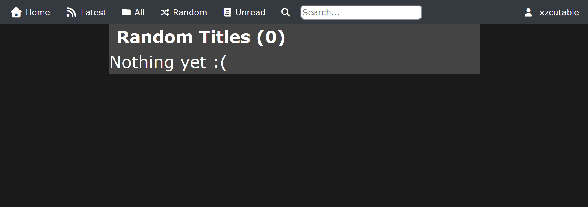
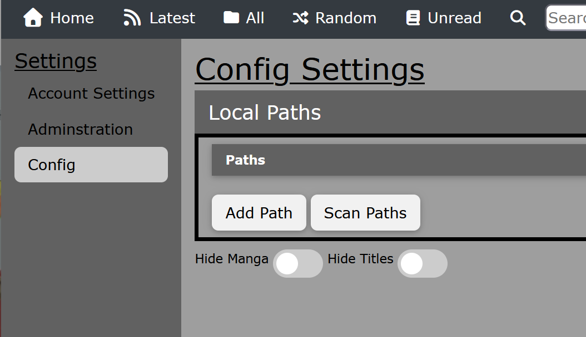
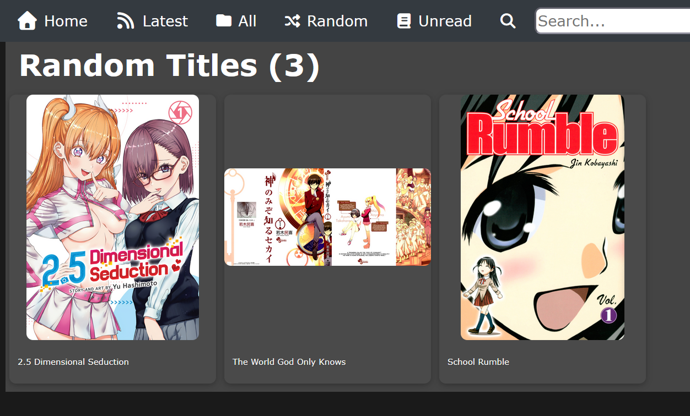

# MyMangaLibrary #
MyMangaLibrary is self hosted manga reading website. It aims to give users the features they expect from a manga reading websites while also keeping control of their data. It also strives to be flexible enough to allow a savy user to share their collections with others or customize their own experience without having to write the backend.

## Quick start with Docker ##
Needs Docker (Docker Desktop on Windows and macOS). One command starts a server; change `/path/to/manga` to where your manga lives:

```sh
docker run -d --name mangalib --restart unless-stopped -p 5000:5000 \
  -v mangalib-data:/data \
  -v /path/to/manga:/var/manga:ro \
  ghcr.io/xzcutable/mangalib --site-name "My Library"
```

Then open http://localhost:5000 and create the owner account. Your manga is already there: the library folder is added and scanned on first start.

Or with Compose: put your manga in a `manga` folder next to [compose.yml](compose.yml) (or change `./manga` in it), then run `docker compose up -d`. Settings you'd pass as flags go in its `command:` line.

**Already running an older version?** Follow [UPGRADING.md](UPGRADING.md) first. The original Docker setup kept its database inside the container, so it has to be copied out before upgrading.

### Options ###
Anything after the image name is a flag (`docker run --rm ghcr.io/xzcutable/mangalib --help` lists them). Flags win over `config.toml`. Settings the owner later changes in the app (site name, sign-ups) win over both.

| Flag | What it does |
|---|---|
| `--site-name NAME` | Name in the browser tab and the app |
| `--allow-new-users` / `--no-allow-new-users` | Let people create accounts |
| `--auto-approve-users` | New accounts can read without waiting for an admin |
| `--no-auto-update` | Don't check for or download updates on its own (the owner can still check in Settings) |
| `--update-check-hours N` | How often to check for updates (default 6) |
| `--url-prefix /manga` | Served at a sub-path by a reverse proxy |
| `--behind-proxy` / `--no-behind-proxy` | Trust `X-Forwarded-*` headers (on in the image) |
| `--cors-origins URL,URL` | Web pages allowed to call the API from a browser |
| `--library PATH` | A library folder to add on first start (the image already uses `/var/manga`) |
| `--library-moved OLD=NEW` | A library folder now mounted at `NEW` instead of `OLD`; the manga keep their reading progress (see [Moving the library](#moving-the-library)) |
| `--port N`, `--host ADDR`, `--threads N` | Where and how the server listens inside the container |

### Updating ###
The server checks GitHub for new versions every few hours and downloads them in the background. Nothing changes until the owner opens **Settings → Server updates** and clicks **Apply and restart**. The server then backs up the database and restarts into the new version, which takes under a minute. People using the site see an "updating" screen and land back on their page. If the new version doesn't start, the server goes back to the old one and restores the backup.

You can also update the image yourself: `docker pull ghcr.io/xzcutable/mangalib` and recreate the container (Compose: `docker compose pull && docker compose up -d`). Updates installed from Settings are kept in the data volume, and a newer image always wins over them.

Notes:
- **Phones and other computers** connect to `http://<this computer's IP>:5000`, in a browser or in the Android app ([releases](https://github.com/XZcutable/MangaLib/releases)).
- **Data:** `config.toml` (with a random secret key), the database, cover cache, downloaded updates and database backups are all in `/data`. Compose keeps it in `./data`. Back that folder up; replacing the container doesn't touch it. Containers set up with the older `/var/db` and `/var/config` volumes keep using them; see [UPGRADING.md](UPGRADING.md#one-data-folder) to switch.
- **Adding manga later:** copy it into the manga folder, then use Settings → Library → Scan.
- **Logs:** `docker logs -f mangalib` (or `docker compose logs -f`) shows the first-start scan and any warnings.
- **Building the image yourself:** `docker compose -f compose.yml -f compose.build.yml up -d --build`.
- **Classic interface:** still available at http://localhost:5000/classic/.

### Moving the library ###
Manga are stored with their full path, so the server has to be told when files move. Reading progress, scores, tags and read marks carry over either way.
- **A whole library folder moved** (new disk, new mount path): move the files, then use **Settings → Library →** the move icon next to the folder, and pick where it is now. In Docker you can instead change the mount and start once with `--library-moved /old/path=/var/manga` (or `LIBRARY_MOVES={'/old/path' = '/var/manga'}` in `config.toml`). It's skipped once done, so it can stay.
- **One series to another library folder:** open the series, then **Manage → Move to another folder**. The server moves the files itself (copying first when the folders are on different disks). The library must be mounted read-write for this; the example `compose.yml` mounts it `:ro`.

## Deployment or Development ##
To setup, first you must clone the project and have python installed. Some systems may use python3, but this will assume just 'python' will work. 

1\. While not technically necessary, it is recommened to first create a venv. To setup the venv environment run: <br>
`python -m venv .venv`

It is assumed the venv was created in the root directory of the project.

2\. Then activate the venv:
`.\.venv\Scripts\activate` on windows or `. .venv/bin/activate` for linux

3\. Then install the server and its dependencies (Flask and friends), this is why a venv is recommened:
`pip install -e .`

4\. Finally run the server with a command like: <br>
`flask --app mymangalib run --host=0.0.0.0`

Depending on your needs, the command may be different.

To deploy, you'd follow the same steps except for the last one. You'd need to choose a [WSGI Server](https://flask.palletsprojects.com/en/stable/deploying/). The ones I tested are [Gunicorn](https://flask.palletsprojects.com/en/stable/deploying/gunicorn/) and [Waitress](https://flask.palletsprojects.com/en/stable/deploying/waitress/). But I find I perfer Gunicorn because it supports passing a string on startup, but waitress works if you don't need that.

The links explain how to install the server and application. But boils down to: <br>
> pip install \<server\>
<br>
 pip install -e .

Deployment commands would look something like:
> <b>myMangaLib's own launcher</b> (recommended; it can install updates from Settings): <br>
mymangalib serve --host 0.0.0.0 --port 5000 --library /path/to/manga <br>
(`python -m mymangalib serve ...` from a checkout. The same flags as the Docker image; `mymangalib --help` lists them.)

> <b>Waitress:</b> <br>
waitress-serve --host=0.0.0.0 --port=5000 --call mymangalib:create_app

> <b>Gunicorn:</b> <br>
gunicorn -w 2 --bind=0.0.0.0:5000 'mymangalib:create_app()'

And then running the server with something like (for Linux): <br>
`(waitress-serve --host=0.0.0.0 --port=5000 mymangalib:app > /dev/null 2>&1 &)`

That will run the server in the background.

# Mobile app and new front end #
`manga-site/` holds the new front end. It runs in a browser and as an Android/iOS app. See [manga-site/README.md](manga-site/README.md).

It uses the JSON API under `/api/v1`, which logs in with tokens instead of cookies:

```sh
curl -X POST http://localhost:5000/api/v1/auth/login -H "Content-Type: application/json" \
     -d '{"username": "me", "password": "...", "device": "curl"}'
# -> {"token": "...", "user": {...}}
curl http://localhost:5000/api/v1/manga?list=all -H "Authorization: Bearer <token>"
```

Run the API tests with `pytest tests`.

## Serving the new interface ##
Set `FRONTEND_PATH` in `config.toml` (or the `FLASK_FRONTEND_PATH` environment variable) to the built front end, for example `manga-site/dist` after running `pnpm build` in `manga-site/`. The server then shows the new interface at `/` and moves the classic one to `/classic/`. Leave it empty to keep the classic interface at `/`.

The Docker image builds the front end and turns this on. Owners manage library folders, scanning, users and tags in the new interface under Settings; the classic interface stays available at `/classic/` in the meantime.

## Running behind a reverse proxy ##
The server works behind nginx, Caddy, Traefik and similar proxies, with or without HTTPS. Set `BEHIND_PROXY=true` in `config.toml` (the Docker image already does). Leave it off when the server is reached directly, so clients can't fake their address.

**Its own address** (`https://manga.example.com`): forward everything to the server. With nginx:

```nginx
location / {
    proxy_pass http://127.0.0.1:5000;
    proxy_set_header Host $host;
    proxy_set_header X-Forwarded-For $proxy_add_x_forwarded_for;
    proxy_read_timeout 600s;
}
```

**A sub-path** (`https://example.com/manga/`): the new interface, the app and the classic interface all work there. Pick one of two setups:

- **The proxy removes `/manga`** (note the `/` at the end of `proxy_pass`) and says so with `X-Forwarded-Prefix`. Needs `BEHIND_PROXY=true`.

  ```nginx
  location /manga/ {
      proxy_pass http://127.0.0.1:5000/;
      proxy_set_header Host $host;
      proxy_set_header X-Forwarded-For $proxy_add_x_forwarded_for;
      proxy_set_header X-Forwarded-Prefix /manga;
      proxy_read_timeout 600s;
  }
  ```

- **The proxy passes `/manga/...` through unchanged** (no `/` at the end of `proxy_pass`). Tell the server with `URL_PREFIX='/manga'` in `config.toml` (`FLASK_URL_PREFIX=/manga` for Docker).

  ```nginx
  location /manga/ {
      proxy_pass http://127.0.0.1:5000;
      proxy_set_header Host $host;
      proxy_read_timeout 600s;
  }
  ```

In the Android app, the server address is the full one, e.g. `https://example.com/manga`. With either setup the server still answers on its own address too (e.g. `http://192.168.1.20:5000` at home).

Good to know:
- **`proxy_read_timeout`:** "Scan" in Settings waits until the scan is done. A first scan of a big library can take longer than nginx's default 60 seconds; the scan still finishes, but the page shows an error.
- **Pass the `Authorization` header** (most proxies do by default). The app logs in with it.
- **A proxy login in front of the server** needs `/api/v1/` left out of it (below).

### With a proxy login (basic auth, Authelia, Authentik, Cloudflare Access) ###
A login page in the proxy blocks the Android app: it can't fill in a browser login page or keep the proxy's cookie. Leave `/api/v1/` out of the proxy login, and keep the rest of the site behind it.

This is safe:
- **The server protects `/api/v1/` itself.** Everything there needs a myMangaLib login token, except checking that the server exists, logging in, and signing up (only when sign-ups are on).
- **The app only uses `/api/v1/`.**
- **The browser still needs the proxy login.** The web interface and the classic interface stay behind it, and the web interface's own API calls work as before.

Your proxy's setting for this:

- **nginx (basic auth):**

  ```nginx
  location / {
      auth_basic "Manga";
      auth_basic_user_file /etc/nginx/htpasswd;
      proxy_pass http://127.0.0.1:5000;
  }
  location /api/v1/ {
      auth_basic off;
      proxy_pass http://127.0.0.1:5000;
  }
  ```

- **Caddy:**

  ```caddy
  manga.example.com {
      @needs_login not path /api/v1/*
      basic_auth @needs_login {
          family <password hash from "caddy hash-password">
      }
      reverse_proxy 127.0.0.1:5000
  }
  ```

  For Authelia or Authentik, put the same `@needs_login` matcher on `forward_auth`.

- **Authelia:** a `bypass` rule above the site's other rules:

  ```yaml
  access_control:
    rules:
      - domain: manga.example.com
        resources: ['^/api/v1/']
        policy: bypass
      - domain: manga.example.com
        policy: one_factor
  ```

- **Authentik:** in the proxy provider, add `^/api/v1/` to **Unauthenticated Paths**.

- **Cloudflare Access:** add a second Access application for `manga.example.com/api/v1` with a policy whose action is **Bypass** (include: Everyone). The more specific path wins over the site's application.

- **Traefik:** a second router for `/api/v1` without the auth middleware:

  ```yaml
  - "traefik.http.routers.manga-api.rule=Host(`manga.example.com`) && PathPrefix(`/api/v1`)"
  - "traefik.http.routers.manga-api.priority=100"   # checked before the site's router, which has the auth middleware
  ```

With a sub-path, add it to the path (`/manga/api/v1/`).

## Changing the site name ##
The site is called "myMangaLib" by default. The name appears in the browser tab, on the login screen and at the bottom of every page, in both interfaces.

**As the owner, in the app:** Settings → Library → Display → **Site name**, then **Save**. It takes effect straight away for everyone and is kept after restarts. Leave it empty to go back to the default.

**In the config:** set `SITE_NAME` in `config.toml` (or the `FLASK_SITE_NAME` environment variable), then restart:

```toml
SITE_NAME='My Manga'
```

This is the starting name; a name saved in Settings wins over it.

**In the code**, to change the default for everyone who builds from your copy:

| What | Where |
|---|---|
| Default name on the server | `DEFAULT_SITE_NAME` in `mymangalib/server/server_settings.py`, and `SITE_NAME` in `DEFAULT_CONFIG` in `mymangalib/constants.py` (written into new configs) |
| Tab title before the app has reached the server | `<title>` in `manga-site/index.html`, and `DEFAULT_SITE_NAME` in `manga-site/src/app/context/AuthContext.jsx` |
| Name under the Android app's icon | `appName` in `manga-site/capacitor.config.json` and `app_name` in `manga-site/android/app/src/main/res/values/strings.xml` |

Changes to `manga-site` take effect after rebuilding: `docker compose up -d --build` for Docker, or `pnpm build` in `manga-site/`. The Android app picks them up in its next release.

Don't change `"name": "myMangaLib"` in `server_info()` in `mymangalib/blueprints/api_v1.py`. The app checks it to recognize a myMangaLib server. If it changes, the app refuses to connect.

# Onboarding #
After the server is running, going to the url will take you to the simple onbaording process of making an Owner Account. After creating the account you will be taken to the login page. The home page will be empty but will select a random amount of registered titles when avaiable.

<details>
<summary><i>Screenshots</i></summary>





</details>

# Adding Manga #
As the Owner, navigate to the settings. Under `Settings`, go to `Config`. Under `Local Paths`, click `Add Path`. A Folder Picker will pop up and you will navigate to the parent folder that holds all your manga. The path is now is now added. You can either start a scan by clicking `Scan Paths` or by clicking the Path and clciking `Ok` when prompted to rescan. If cancel is selected, you will be asked if you want to remove the Path.

<details>
<summary><i>Screenshots</i></summary>







</details>

# Manga Structure #
THe structure for Manga is very easy. It starts with a folder in one of the paths you created and images inside of that folder or a subfolder. The ordering is the same way Windows Explorer does it. The current supported image types are ['.jpg', '.jpeg', '.png', '.webp', '.jfif', '.gif']. CBZ files are also supported and do not require a folder, but can be stored in one.

## Technical Requirements ##
This project aims to be as effcient and demand little of the host machine. It was developed and ran on a Raspberry Pi5 running Debian 12. That Pi5 was also hosting a Nginx server, a proxy, and HomeAssisant and suffered no performance issues. The application is constantly stress tested and performed smoothly with over a 1000 titles with 76,000 pages hosted on the device itself, external harddrive and remote network location. Python 3.11.2 was used when testing the application.

## Implemented Features ##
- CBZ, PDF, and ['.jpg', '.jpeg', '.png', '.webp', '.jfif', '.gif'] support
- User creation and login
- Manga progress
- Manga Tags
- Random Titles on homepage, Latest, All, Radmon and Unread
- Search title, tags and status (Needs doucmentation)